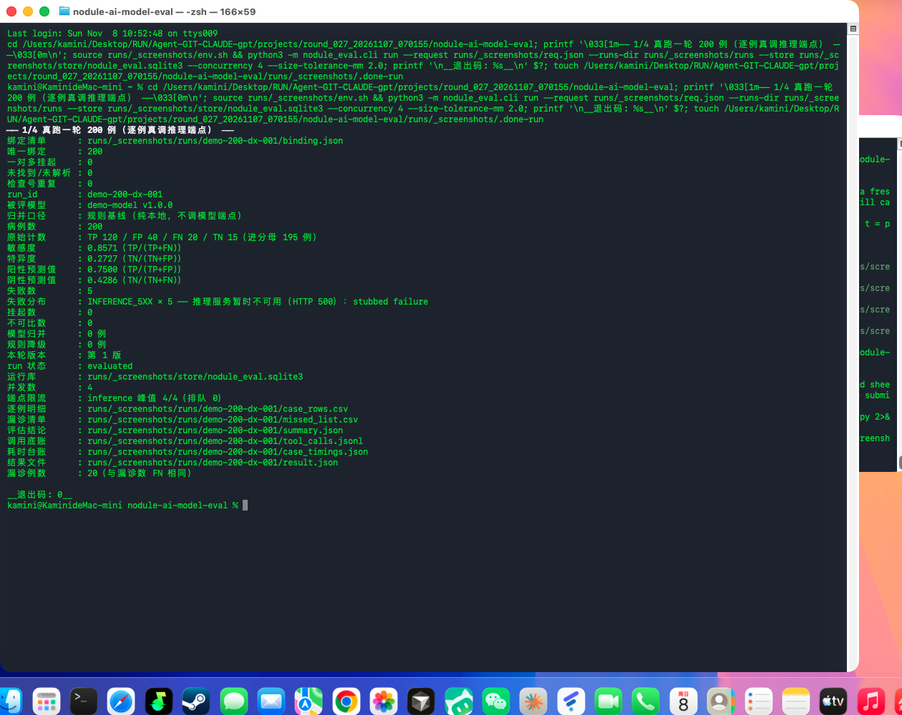
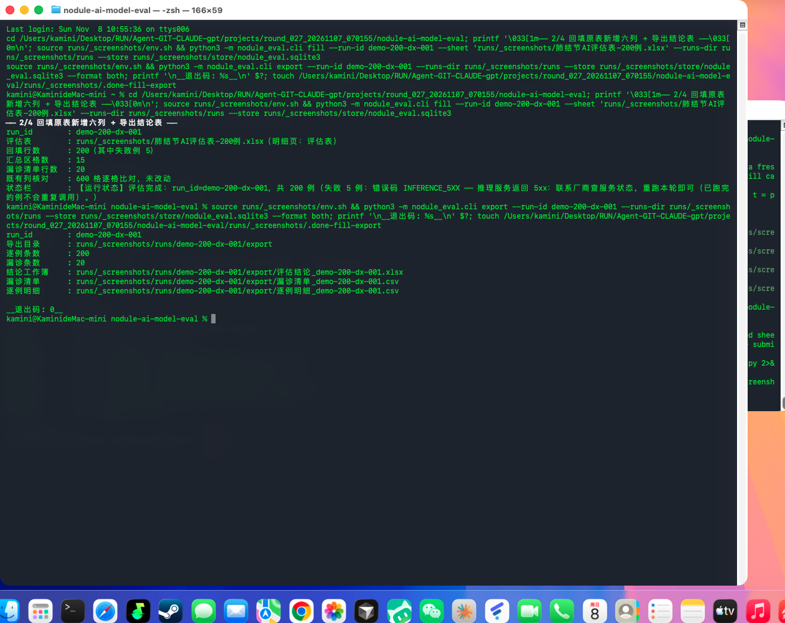
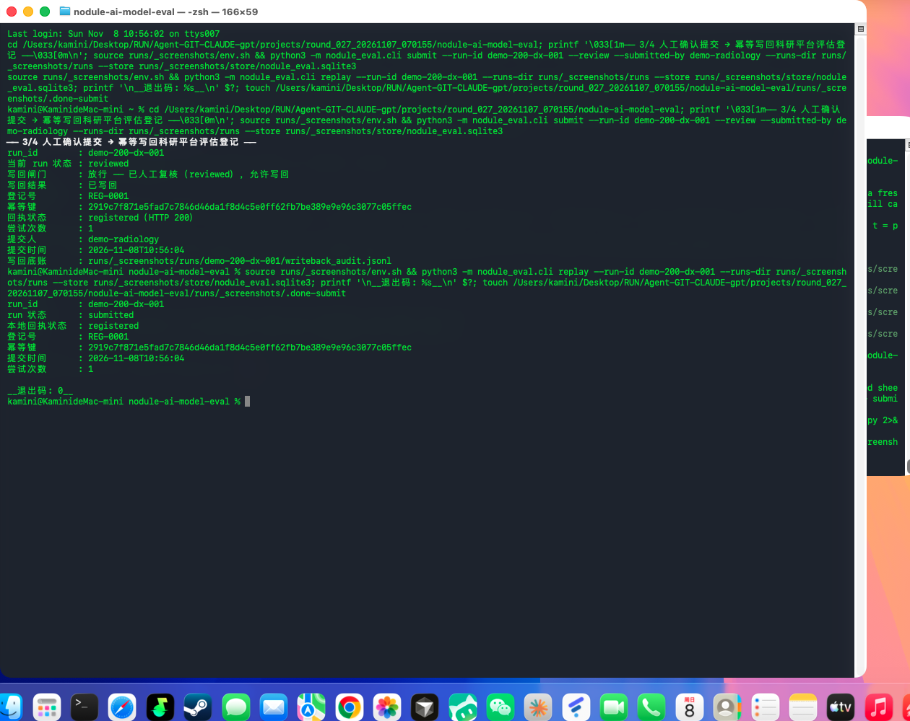
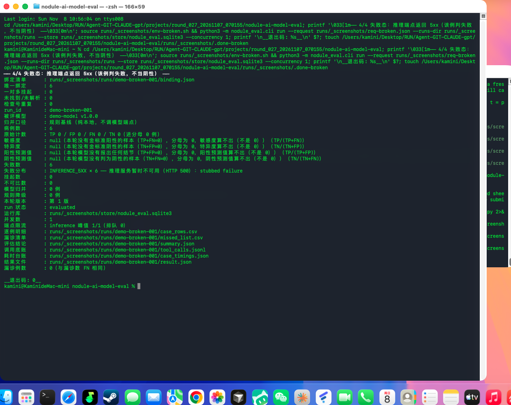
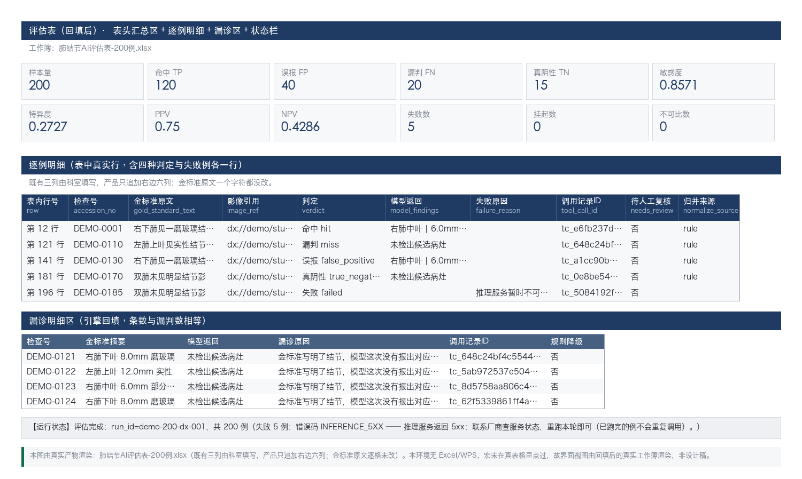
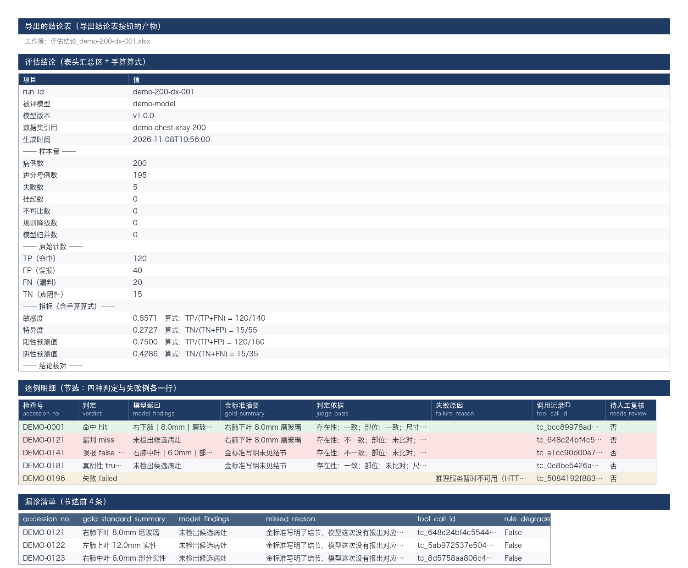
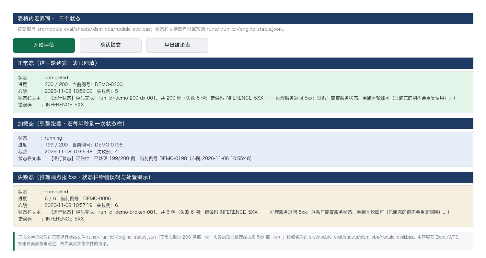

# 肺结节AI模型评估系统

> 放射科交来一张两百例的胸片肺结节评估表，信息科在表里点一次「开始评估」，本机引擎就逐例去调院内那款肺结节 AI 的推理服务，把「命中 / 漏判 / 误报 / 真阴性 / 失败」与敏感度、特异度回填到**原表新增列**；当天交出一份带逐例明细与调用记录的评估结论，任何一个漏判例都能凭「调用记录ID」反查到那次推理的入参与返回，人工复核确认后再由引擎幂等写回院内科研平台的评估登记。

本系统只管**胸片（DX）肺结节的检出与测量**这一件事：采购一款肺结节 AI、换新版本、或做年度复评时，用同一批带金标准的病例，量出它漏了多少、误报了多少。不做 CT / MR、不做其他器官、不做分割类指标、不做联邦评测。**表格是界面，引擎是本机命令行进程**，两者用一份 JSON 契约交接；不引入 Web 面板、不引入常驻对外端口。

## 适用场景 / 目标岗位

| 岗位 | 什么时候用 | 得到什么 |
|------|------------|----------|
| 信息科临床 AI 应用岗 | 采购 / 升级 / 换版一款肺结节 AI 后，上线前逐例跑一遍 | 一张填好判定与敏感度、特异度的评估表，附逐例明细与漏诊清单 |
| 信息科临床 AI 应用岗 | 厂商交付新版模型，需要和旧版比一比 | 同一批病例的两次评估结论，差异逐例可查 |
| 放射科副主任 | 填完金标准列之后，想知道 AI 到底判得准不准 | 命中 / 漏判 / 误报 / 真阴性逐例结论，漏诊例可一键翻出模型原始返回 |
| 放射科副主任 | 对某几例判定有争议，要看 AI 当时看到了什么 | 每例的「调用记录ID」，据此反查那次推理的入参与返回 |
| 科研 / 伦理材料 | 写论文或伦理备案，要引用这次评估的结论 | 带 `run_id` 的评估结论，已写回院内科研平台登记 |

频次：月频或事件驱动，单次 200–500 例。**不含**日常实时诊断。

## 能力要点

- **表格里点一次，跑完整批病例**：圈定病例 → 点「开始评估」→ 引擎逐例调院内推理服务，判定直接回填原表新增列，既有列一格不动；状态栏实时显示「已处理 N/总数 · 当前例号」，表格不冻结。
- **五个互斥结论，一眼分清**：每例落「命中 / 漏判 / 误报 / 真阴性 / 失败」之一；失败就是失败，不会被当成阴性混进敏感度。
- **指标能人工手算复核**：汇总区同时给原始计数（TP / FP / FN / TN）、敏感度 / 特异度 / PPV / NPV、失败数、降级数、挂起数、不可比数；分母为 0 时给「无样本」而不是给 0。
- **漏判例一键定位到原调用**：每一行带「调用记录ID」，拿它能查回那次推理的入参与返回，回答「这例凭什么算漏判」。
- **金标准原文永不被改写，没复核就不外发**：模型只往自己的归并列写，金标准列与既有业务列一个字符都不动；结论默认停在草稿层，只有人工点「确认提交」才写回科研平台，重复提交同一次评估对端只产生一条登记。

## 快速开始

**上手顺序是表格优先**：装好引擎与宏之后，日常操作全在评估表里完成 ——

1. 打开评估表（`templates/eval_template.xlsx` 或科室自带的表），填好检查号与金标准文字；
2. 点「开始评估」，状态栏开始走「已处理 N/总数 · 当前例号」；
3. 看表头汇总区（样本量、TP/FP/FN/TN、四项指标）与逐例明细区（五个判定 + 失败原因 + 调用记录ID）。

命令行只是**运维与排障通道**（跑批、补跑、反查产物、导出结论表），下面是它的前置条件与常用命令。

### 依赖

Python **3.11**（院内交付口径；3.10 也能跑，`doctor` 会提示）；依赖包 `requests`、`PyYAML`、`openpyxl`、`python-dotenv`；表格侧用 Microsoft Excel（加载宏）或 WPS 表格（JSA 宏）任选其一；院内可达三个端点：RIS（读）、厂商肺结节 AI 推理服务（写）、院内科研平台（写）。

### 安装

```bash
python3 -m venv .venv && source .venv/bin/activate   # Windows: .venv\Scripts\activate
pip install -r requirements.txt                       # 装依赖
pip install -e .                                      # 装本项目（开发模式，便于直接跑 tests/）
```

表格内三个按钮的宏另装一份，见 [`docs/macro_install.md`](docs/macro_install.md)：Excel 侧要在「信任中心」把评估表所在目录加为受信任位置，WPS 侧要关掉沙箱保护；两份宏都不依赖第三方库、不需要 ActiveX 控件。宏装不上也能用 —— 命令行直跑与 `fill` 回填是无宏退路。

### 配置

凭据**只从环境变量读**，代码里不设任何静默默认值，也不会自动回落到本地替身。把 `.env.example` 复制成 `.env` 填入院内实际值即可（完整变量表见下方「关键配置项」，离线安装见 [`docs/install.md`](docs/install.md)）：

```bash
cp .env.example .env    # 编辑 .env，填入三个端点的地址与令牌、模型网关地址与模型名
```

配置没填全时不要猜 —— 跑 `doctor` 会指名报出缺哪一个变量。

### 构建与验证

```bash
bash scripts/verify.sh                 # 一键全流程验证：装依赖 → 生成评估表 → 跑一轮 fixture 评估 → doctor → 断言产物存在
python -m nodule_eval.cli doctor       # 自检：配置、凭据、模型目录、存储可写性（零出站）
python -m pytest tests/ -q             # 跑测试
python scripts/build_xlsm.py --out templates/eval_template.xlsx   # 生成空白评估表模板
```

### 主命令速查

```bash
python -m nodule_eval.cli doctor                                    # 装完先自检（缺哪个环境变量就指哪个）
python -m nodule_eval.cli run --cases cases.json --model-id <模型>    # 逐例评估（默认真外发，不带 --fixture）
python -m nodule_eval.cli assemble --cases cases.json                 # 装配本院病例集（重复装配会跳过）
python -m nodule_eval.cli submit --run-id <run_id>                    # 人工复核确认后写回科研平台登记
python -m nodule_eval.cli inspect --tool-call-id <调用记录ID>         # 反查某次推理调用的入参与返回
python -m nodule_eval.cli export --run-id <run_id> --out-dir exports/ # 导出结论表与漏诊清单（无宏退路）
python -m nodule_eval.cli fill --sheet 评估表.xlsx --run-id <run_id>  # 回填判定进评估表（只写新增六列）
```

各子命令的完整参数、产物落点、退出码见 [`docs/cli.md`](docs/cli.md)。

## 命令 / API / 配置说明

### 关键配置项

| 配置项 | 默认值 | 说明 |
|--------|--------|------|
| `RIS_BASE_URL` / `RIS_API_TOKEN` | 无（必填） | 院内 RIS 根地址（按检查号取检查清单）／ 访问令牌，`Authorization: Bearer` 用 |
| `INFERENCE_BASE_URL` / `INFERENCE_API_TOKEN` | 无（必填） | 厂商肺结节 AI 推理服务根地址 ／ 访问令牌 |
| `RESEARCH_PLATFORM_BASE_URL` / `RESEARCH_PLATFORM_TOKEN` | 无（必填） | 院内科研平台根地址 ／ 访问令牌 |
| `OPENAI_BASE_URL` / `OPENAI_API_KEY` / `OPENAI_MODEL` | 无（必填） | 模型网关地址（OpenAI-compatible 协议）／ 密钥 ／ 语义归并用的模型名 |
| `MODEL_TIMEOUT` / `MODEL_MAX_RETRIES` / `MODEL_TEMPERATURE` | `20` / `2` / `0` | 模型调用超时秒数 ／ 重试上限 ／ 归并温度（固定 0 以保证可复现） |
| `--fixture` / `IMAGING_EVAL_FIXTURE` | 关闭 / `0` | **仅供自动化测试**：把出站路由到 `tests/` 下的本地替身，正式路径**必须**不带 |
| `--store` | `%LOCALAPPDATA%/nodule-ai-model-eval/` | SQLite run store 落盘目录 |
| `--run-id` / `--model-id` | 自动生成 / 必填 | 本次评估的标识（产物目录与幂等键按它归拢）／ 被评模型标识（对应 `models/<model_id>.yaml`） |
| `--concurrency` / `--endpoint-limits` | `4` / 跟随并发数 | 并发上限（超出的排队不丢弃）／ 逐端点在途上限（端点名写错当场报错） |
| `--size-tolerance-mm` / `--resume` | `2.0` / 关闭 | 尺寸比对容差（恰好等于阈值算命中）／ 断点续跑：已完成例跳过，不重复调用、不重复写记录 |
| `--merge` | `rule` | 归并口径：`rule` = 规则基线（纯本地）；`model` = 语义归并（调院内模型服务，不可达时**自动降级为规则基线**，该例仍计入指标并单列「规则降级」） |

### CLI 子命令 / 接口端点

| 命令或路径 | 用途 | 关键参数 |
|------------|------|----------|
| `run` / `assemble` | 逐例评估一批病例，产出判定、指标、漏诊清单与调用底账 ／ 从 RIS 装配本院病例集（按检查号幂等，二次装配一次 RIS 都不打） | `--cases` `--request` `--model-id` `--resume` `--concurrency` `--merge` ／ `--accession` `--modality` `--from` `--to` |
| `submit` | 人工复核确认后幂等写回科研平台评估登记（未复核一次出站都不发） | `--run-id` `--review` `--dry-run` `--submitted-by` |
| `inspect` | 按调用记录ID 反查那次推理的入参与返回，并 join 回逐例结论 | `--tool-call-id` `--run-id` `--snippet` `--json` |
| `redact-scan` / `replay` | 扫产物查患者可识别明细 ／ 回放写回回执（默认零出站） | `--run-id` `--json` ／ `--run-id` `--verify` `--json` |
| `doctor` | 逐项自检配置、凭据、模型目录、存储与依赖（零出站、不打开替身门） | `--json` `--store` `--models-dir` `--runs-dir` `--verify-dataset` |
| `export` / `fill` | 导出结论表与漏诊清单 ／ 把判定回填进评估表（只写新增六列） | `--run-id` `--out-dir` ／ `--sheet` `--run-id` |
| `GET {RIS_BASE_URL}/api/v1/imaging-studies` | 出站**读**：按检查号取本院胸片检查清单（游标翻页） | `modality=DX` `from` `to` `cursor` |
| `POST {INFERENCE_BASE_URL}/api/v1/detections` | 出站**写**：逐例调用被评模型做结节检出与测量 | `study_uid` `image_ref` `model_id` `model_version` |
| `POST {RESEARCH_PLATFORM_BASE_URL}/api/v1/model-evaluation-runs` | 出站**写**：人工确认后登记评估结论 | `Idempotency-Key` 头 + 指标与逐例明细体 |
| `POST {OPENAI_BASE_URL}/chat/completions` | 模型网关：自由文本金标准 → 固定标签集语义归并 | JSON Schema 结构化输出 |

### 错误与降级

| 场景 | 表现 | 处理方式 |
|------|------|----------|
| 凭据环境变量缺失 | `doctor` / `run` 直接报错 | **指名报出缺哪一个变量名**，绝不静默回落到本地替身 |
| 同一检查号命中多张影像 / 多个时间点 | 该例挂起 | 判为「一对多歧义」，不自动取第一条，挂人工判定，且不进指标分母 |
| 推理服务返回的检查号与请求不一致 / 响应缺字段 | 该例判失败 | 不进指标分母，不当阴性；失败原因写明「检查号不一致」或缺哪一个字段，不填 0、不返回空候选冒充阴性 |
| 推理服务 5xx / 429 | 退避后重试 | 指数退避、最多 3 次；仍失败则该例判失败，其余例继续 |
| 推理服务 4xx | 不重试 | 立刻结束该例，不消耗退避预算，失败原因带状态码与字段名 |
| 模型网关不可达 / 超时 / 返回不可解析 | 归并降级 | 回退规则基线，该例标「规则归并」并计入降级数，仍参与指标但汇总行注明降级例数 |
| 写回科研平台 5xx | 退避重试后仍失败 | 状态**不推进**，不标记为已提交，错误码与状态码留痕 |
| 写回提交体超出科研平台上限 | 提交被拦下，**一个请求都没发** | 报错写明实际字节、上限与「每批约几例」，**逐例明细一条不截断**；按提示另起一轮分批提交 |
| 重复提交同一次评估 | 对端只产生一条登记 | 幂等键 `sha256(run_id|model_id|dataset_ref)`，重放不新增 |

> **同一类失败，三处是同一句话**：评估表的 `failure_reason` 列、终端输出的「失败分布」、
> `summary.json` 的 `failures` 段读的是**同一个函数**的返回值，一致性不靠人工核对维持；每个错误码在哪儿触发、
> 能不能重试、进不进指标分母、用户在哪个面能看到，逐码登记在 [`docs/error_matrix.md`](docs/error_matrix.md)
> （由代码生成，`python scripts/gen_error_matrix.py --check` 可核对）。

### 对接现有系统

出站**仅三处**，无数据库服务、无账号体系、无对外暴露的接口面。凭据一律从环境变量读，代码里不硬编码。

| 对端 | 方向 | 端点与字段 | 凭据来源 |
|---|---|---|---|
| 院内 RIS | 读 | `GET {RIS_BASE_URL}/api/v1/imaging-studies?modality=DX&from=&to=` → `{"items":[{"accession_no","study_uid","modality","study_date","report_status","image_ref"}],"next_cursor":...}` | `$RIS_API_TOKEN` |
| 厂商肺结节 AI 推理服务 | 写 | `POST {INFERENCE_BASE_URL}/api/v1/detections`，体 `{study_uid, image_ref, model_id, model_version}` → `{"study_uid","model_id","model_version","candidates":[{"position","size_mm","density","confidence"}]}` | `$INFERENCE_API_TOKEN` |
| 院内科研平台 | 写 | `POST {RESEARCH_PLATFORM_BASE_URL}/api/v1/model-evaluation-runs`，头 `Idempotency-Key: sha256(run_id|model_id|dataset_ref)`，体 `{run_id, model_id, model_version, dataset_ref, metrics, case_rows, submitted_by, submitted_at}` | `$RESEARCH_PLATFORM_TOKEN` |

厂商之间对「结节大小」「位置」「密度」的字段命名不统一（`size_mm` / `diameter_mm` / `size`），这些差异收在 `models/<model_id>.yaml` 的响应字段映射里，业务代码里不出现厂商字段名；映射缺字段会显式失败并写明缺哪一个，不猜、不填默认值。本地替身（fixture 推理服务 / fixture RIS / fixture 科研平台）**只存在于 `tests/`**，且只能经 `--fixture` 或 `IMAGING_EVAL_FIXTURE=1` 显式开启；它是验证手段，**不是**最终对接面。

## 典型场景

### 场景 1：放射科交表，信息科点一次「开始评估」

1. 放射科把本院胸片病例填进评估表：检查号一列、金标准文字一列（可多行），图像引用留空也行；信息科在表里圈定这批病例。
2. 点「开始评估」→ 宏把请求写成 JSON，唤起本机引擎；引擎逐例调院内推理服务，回填六个新增列，表头汇总区出样本量、TP/FP/FN/TN 与四项指标。
3. 放射科与信息科在表内复核；有争议的例标成待复核。

```bash
python -m nodule_eval.cli assemble --cases 评估表病例.json --modality DX   # 无宏环境等价路径
python -m nodule_eval.cli run --cases 评估表病例.json --model-id demo-model
```

### 场景 2：厂商换版本，两版跑同一批病例

1. 复制上一版评估表，把被评模型换成新版本对应的 `model_id`。
2. 用**同一批检查号**再跑一次，产出另一套新增列与汇总指标。
3. 两版结论并排看：漏判从哪几例变成哪几例、误报多在哪里、失败例落在哪一侧。

```bash
python -m nodule_eval.cli run --cases 评估表病例.json --model-id second-model --run-id eval-v2
python -m nodule_eval.cli export --run-id eval-v2 --out-dir exports/v2/
```

### 场景 3：漏判例追到原始调用，写成招采说明

1. 从漏诊清单里挑出一例，记下它的「调用记录ID」。
2. 反查那次推理的入参与返回：送进去的是哪张片、哪个检查号、哪个模型版本；返回了几个候选、位置大小密度各是多少。
3. 把这段连同判定依据一起贴进招采 / 换版说明的附件里。

```bash
python -m nodule_eval.cli inspect --tool-call-id <调用记录ID> --snippet
```

## 输出样例

产物落点：`runs/<run_id>/`。下列样例取自一次**真实运行**（200 例脱敏胸片评估表 `demo-200-dx-001`），检查号一律占位符；全部产物样例见 [`docs/examples.md`](docs/examples.md)。

### 逐例判定（`runs/<run_id>/case_rows.csv`）

```csv
accession_no,verdict,model_findings,failure_reason,tool_call_id,needs_review,normalize_source,row_no
<ACCESSION_NO_A>,hit,右下肺 | 8.0mm | 磨玻璃,,tc_<ID_0001>,False,rule,2
<ACCESSION_NO_C>,miss,未检出候选病灶,,tc_<ID_0003>,False,rule,4
<ACCESSION_NO_D>,failed,,推理服务暂时不可用（HTTP 500）：重试 3 次后仍失败,tc_<ID_0004>,True,rule,5
```

`verdict` 五个互斥值：命中 / 漏判 / 误报 / 真阴性 / 失败；`normalize_source` 是归并口径（`rule` / `model`）。**产物里不落金标准原文** —— 金标准只在评估表里，逐例产物只存内容哈希。

### 汇总结论（`runs/<run_id>/summary.json`）

```json
{"counts": {"tp": 120, "fp": 40, "fn": 20, "tn": 15, "counted": 195, "failed": 5},
 "metrics": {"sensitivity": 0.8571, "specificity": 0.2727, "ppv": 0.75, "npv": 0.4286},
 "manual_check": {"formulas": {"sensitivity": "TP/(TP+FN) = 120/140 = 0.8571"}}}
```

四项指标与原始计数**同出一处**，并附手算复核算式：分母为 0 的指标输出 `null` 并写明原因，不输出 0。判定口径与指标定义见 [`docs/metrics.md`](docs/metrics.md)。

## 概念 / 实测对照

### 视觉目标

视觉目标卡见 [`docs/concepts/visual-target.md`](docs/concepts/visual-target.md)，用结构化文字描述三个状态（起始态 / 首个可用瞬间 / 成形态）的画面元素：**画面类型**是 Microsoft Excel 评估表界面（不是网页面板、不是终端表格）；**视觉语言**为表头深蓝底白字、判定三档低饱和底色（命中 / 漏判 / 失败，可直接黑白打印核对）、数字列等宽右对齐、指标统一四位小数、固定列宽 + 表头冻结；**信息层级**为顶部汇总区 → 中部逐例明细区 → 底部漏诊区与状态栏；**必须可达的约束**是只用 Excel / WPS 公共 API 与 openpyxl 能做出来的效果，无 3D、无动画库、无自定义控件。

### 实测证据

真跑一轮 200 例（`demo-200-dx-001`：TP 120 / FP 40 / FN 20 / TN 15 进分母 195 例，失败 5）采下来的七张图，逐张的命令与出处见 [`docs/screenshots/README.md`](docs/screenshots/README.md)：















> **诚实标注**：上为视觉目标卡描述的形态，下为**真实运行产物**。两者不声称一致，差距有四：
> **①界面载体不同** —— 目标图是 Excel / WPS 窗口，本轮环境没有 Excel / WPS，宏未在真表格里点过，
> 表格界面三态是由**真实产物**（回填后的工作簿、真实运行状态文件、真实导出的结论工作簿）渲染出来的，
> 终端四张则是 Terminal.app 真窗口原样截屏；**②数据是脱敏样例**（检查号一律 `DEMO-xxxx`）；
> **③院内端点未实连** —— 推理 / RIS / 科研平台走的是本地协议替身（真 socket、真 HTTP、真 Bearer 头，协议面跑通，院内凭证本轮拿不到）；
> **④版式有偏差** —— 真实回填后的列宽、行高与目标卡的设想不会逐像素一致。不生成事后效果图去抹平差距。

## 架构与数据流

```
┌──────────────────────────────────────────────────────────────────────┐
│  评估表 xlsm / CSV —— accession_no · gold_standard_text · image_ref  │
│  既有列由科室维护，产品只追加列                                       │
└───────────────────────────────┬──────────────────────────────────────┘
                                │ ① 三入口共用同一份 JSON 契约
                                │   （xlsm 宏 / WPS JSA 宏 / CSV 直跑）
                                ▼
┌──────────────────────────────────────────────────────────────────────┐
│  本机引擎  python -m nodule_eval.cli run                             │
│  caseset ──▶ goldstd ──▶ metrics ──▶ writeback（人工闸门）          │
│  RIS 装配   规则基线/模型  5 值判定    Idempotency-Key 幂等写回       │
│  三键绑定   部位·密度等价表 四项指标                                 │
│      ▲ store（SQLite · 双状态机 · 断点续跑）▼                       │
│      └──── audit：调用底账 / 迁移留痕 / 脱敏扫描 ────┘               │
└────────────┬─────────────────────────────────┬─────────────────────┘
             │ ② 出站（凭据取自环境变量）        │ ③ 回填原表新增列
             ▼                                 ▼
┌───────────────────────────────┐   ┌───────────────────────────────────┐
│ RIS  GET  imaging-studies     │   │ 原表新增六列：                    │
│ 推理 POST detections          │   │ verdict · model_findings          │
│ 科研 POST evaluation-runs     │   │ failure_reason · tool_call_id     │
└───────────────────────────────┘   │ needs_review · normalize_source    │
                                    └───────────────────────────────────┘
```

更细的模块划分、run/case 双状态机与三级审计链路见 [`docs/architecture.md`](docs/architecture.md)。

### 关键不变量

- **幂等键**：写回科研平台带 `Idempotency-Key: sha256(run_id|model_id|dataset_ref)`；同一 run、同一数据集重复提交，对端只产生一条登记。
- **失败不静默改数据、失败不进分母**：调用失败 / 超时 / 检查号不回显 / 响应缺字段一律判「失败」，绝不当作阴性计入指标、绝不填补默认值；失败数、降级数、挂起数、不可比数在汇总行单列，互不吞并。
- **状态校验**：run 状态机 `draft → assembled → running → evaluated → reviewed → submitted`，非法迁移被拒；引擎内部循环**不得**自行推进 `reviewed` / `submitted`。
- **金标准原文不可变、产物脱敏**：模型输出只写 `model_findings` 与 `normalize_source` 两列，既有列与 `gold_standard_text` 逐单元格零改动（回填前后比对断言）；产物只含 `accession_no` 与内容哈希，不落姓名 / 身份证 / 住院号等可识别明细。

## 安全与合规边界

- 本系统只输出**评估统计与差异提示**，不输出诊断建议、不输出治疗建议、不改写报告、不自动签名或代签；金标准原文列与模型归并列物理分离，模型输出永不覆盖原文。
- 产物不落患者可识别明细，只含检查号与内容哈希；交付前有脱敏扫描器逐个产物核对。
- 「已生效事实」层只在人工确认后产生，模型输出永远停在草稿层。
- 首版范围钉死胸片肺结节的检出与测量：不做 CT / MR、不做其他器官、不做分割类指标、不做联邦评测。

### 数据来源与许可

产品跑在院内真实数据上；本地自测与规模验证用一份**公开学术数据集**：**JSRT**（日本放射线技师会公开数据库，247 张正位胸片 + 手绘结节标注，154 例有结节 / 93 例无结节），许可为学术使用条款（各镜像站条款略有出入，**按最严者执行**）。它**只作本地验证数据**：缓存进 `data/jsrt/`（不入库），脱敏样例进 `tests/fixtures/jsrt/`。取数脚本 `scripts/fetch_jsrt.py` 从公开镜像站抓取，**逐文件 SHA256 校验 + 数量必须恰好 247 例**，清单钉在 `scripts/jsrt_manifest.json`；断网时以非零退出码结束，不静默跳过、不留半份数据却报成功。**公开数据不是产品对接面**：院内数据一律走 RIS 读接口；JSRT 原始元数据里的年龄、性别、诊断结论**不搬进仓库**。镜像站地址与来源见 `scripts/jsrt_manifest.json` 的 `source` / `mirror_urls` 字段；原始论文：Shiraishi J, et al. *Am J Roentgenol.* 2000;174(1):71-74。

## 验收与自检

| 验收项 | 命令 | 期望结果 |
|--------|------|----------|
| 依赖装得上、导入不报错 | `pip install -r requirements.txt && python -c "import nodule_eval"` | 安装成功，导入无异常 |
| 凭据缺失被指名报出 | `python -m nodule_eval.cli doctor` | 明确列出缺失的环境变量名，退出码非零，不回落替身 |
| 模板生成且列齐全 | `python scripts/build_xlsm.py --out templates/eval_template.xlsx` | 生成既有列 + 六个新增列的工作簿，含汇总区 / 漏诊区 / 状态栏 |
| 公开数据集取数并校验 | `python scripts/fetch_jsrt.py` ／ `python scripts/fetch_jsrt.py --verify-only` | 247 例逐文件 SHA256 与数量校验全过；断网时退出码非零并给出降级提示；复校（不联网）全过则退出码 0 |
| 逐例评估产出齐全 | `python -m nodule_eval.cli run --cases cases.json --model-id <模型>` | `runs/<run_id>/` 下有 `case_rows.csv`、`tool_calls.jsonl`、`summary.json` |
| 漏诊清单与 FN 计数一致 | `python -m pytest tests/test_report.py -q` | 漏诊清单条数 == FN 计数，汇总反算一致 |
| 调用底账可反查 | `python -m nodule_eval.cli inspect --tool-call-id <ID>` | 返回该次入参与返回，能 join 回逐例结论 |
| 金标准原文零改动 | `python -m pytest tests/test_fill_backfill.py -q` | 回填前后既有列与金标准列逐单元格一致 |
| 归并口径可追（哪一版提示词） | `python scripts/verify_prompt_version.py` | 底账每行 `prompt_sha256` 与 `prompts/goldstd_merge.v1.md` 的文件哈希逐字相同，`prompt_version` 为 `v1` |
| 判定口径与指标定义 | 见 [`docs/metrics.md`](docs/metrics.md) | 五个互斥结论、三类隔离例、四项指标与手算复核算式的定义与实现一致 |
| 一键可重复验证 | `bash scripts/verify.sh` | 装依赖 → 生成评估表 → 跑一次 fixture 验证 → doctor → 断言产物存在，退出码 0 |
| 测试全绿 | `python -m pytest tests/ -q` | 全部通过 |</n_string>

## 项目结构

```
nodule-ai-model-eval/
├── README.md / LICENSE / qrcode.jpg ← 中文产品说明（本文件）／ MIT 许可 ／ 关注公众号二维码
├── requirements.txt             ← 运行与开发依赖清单
├── pyproject.toml               ← 打包元数据（pip install -e . 后可直接 python -m nodule_eval.cli）
├── .env.example / .gitignore    ← 环境变量样例（无真实密钥）／ 排除凭据、缓存、运行时产物
├── docs/
│   ├── cli.md / metrics.md / examples.md / architecture.md ← 子命令全参 · 判定口径与指标定义 · 全部产物样例 · 模块分层与双状态机
│   ├── error_matrix.md / normalizer-comparison.md ← 错误码落地矩阵（代码生成）· 归并对照实验结论
│   ├── install.md / macro_install.md       ← 院内离线安装 · Excel 宏与 WPS JSA 安装与信任目录设置
│   ├── concepts/                ← 视觉目标卡（结构化描述，不伪造图片）
│   └── screenshots/             ← 真实运行截图（终端 / 结论表 / 表格三态）与逐张出处清单
├── models/, prompts/            ← 被评模型目录（端点路径 / 版本 / 响应字段映射 / 授权开关）· 语义归并 system prompt（外置可版本化，哈希入调用元数据）
├── scripts/
│   ├── fetch_jsrt.py / build_xlsm.py         ← 公开数据集取数与校验 · 评估表模板生成
│   ├── compare_normalizers.py / bench_scale.py ← 归并对照实验 · 2000 例规模并发压测
│   ├── capture_screenshots.py / gen_error_matrix.py ← 采真实运行截图 · 生成错误码矩阵
│   ├── verify_*.py              ← 各条主路径的实跑核对（契约 / doctor / 宏交接 / 回填 / 提示词 / 写回闸门 …）
│   └── verify.sh                ← 一键可重复验证脚本
├── src/nodule_eval/
│   ├── cli.py                   ← run / assemble / submit / inspect / replay / doctor / export / fill
│   ├── config.py / contracts.py / errors.py  ← 环境变量配置面 · 三入口共用契约 · 统一错误码表
│   ├── engine.py / store.py     ← 逐例 fan-out 调度与失败隔离 · SQLite run store 与双状态机
│   ├── caseset.py / catalog.py / gateway.py / writeback.py ← 病例集与三键绑定 · 模型目录 · ModelGateway · 人工闸门写回
│   ├── adapters/                ← 出站层：http / ris / inference / research_platform / vendor_error
│   ├── datasets/                ← 公开数据集取数与校验（jsrt：下载 / 解包 / 逐文件哈希 / 脱敏样例）
│   ├── goldstd/                 ← 金标准归并：labels 等价表 / rules 规则基线 / merge 语义归并 / prompt 提示词版本化
│   ├── metrics/                 ← judge 判定 / attributes 属性三层 / strict 多标签最严 / compute 指标 / report 结论
│   ├── audit/                   ← toolcall 底账 / modelcall 元数据 / state_transition 迁移留痕 / redact 脱敏扫描
│   └── sheets/                  ← 表格层：columns 列契约 / template 模板 / tokens 视觉 token / status 状态 / fill 回填 / xlsm_vba / wps_jsa
├── tests/                       ← 测试与替身（替身只在此层，且需显式开启）
│   └── fixtures/                ← 病例输入样例 / 模型目录样例 / 公开数据脱敏样例 / 边界场景样例
└── data/                        ← 运行时缓存（已 gitignore：JSRT 归档与图像落在这里）
```

## License

MIT

---

## 关注我们

欢迎扫码关注公众号，获取项目更新与交流加群：

