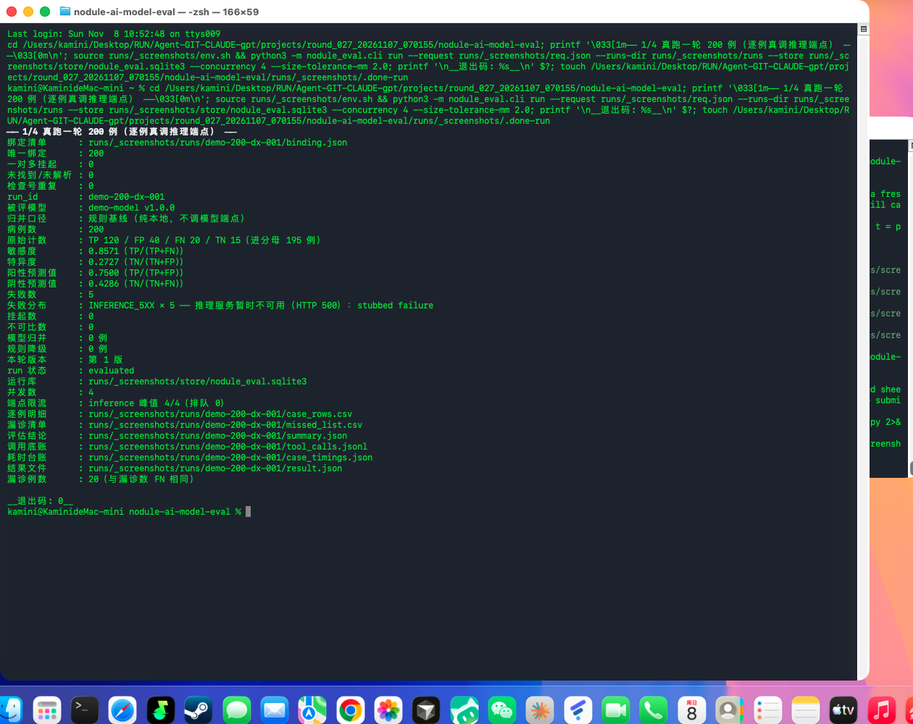
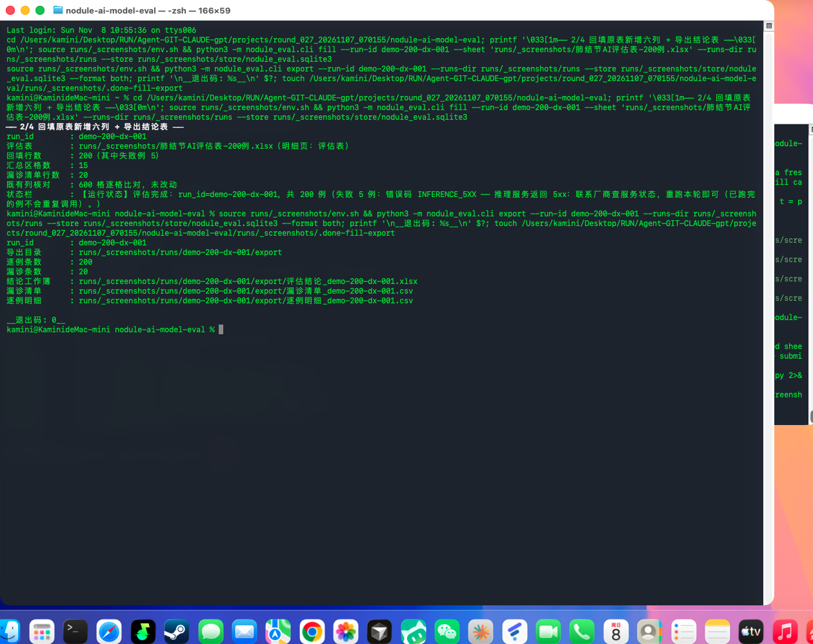
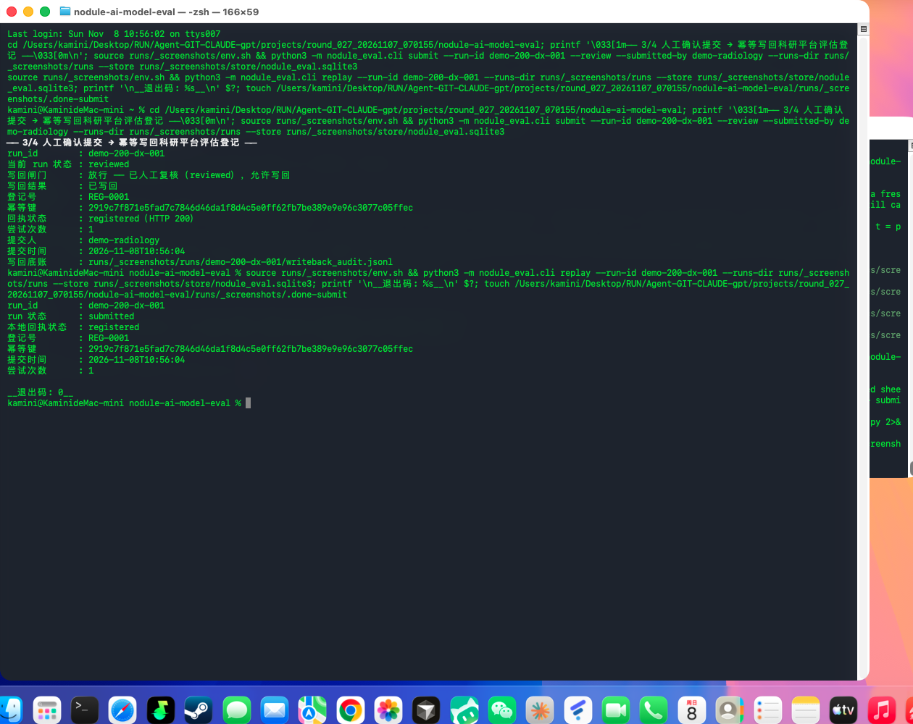
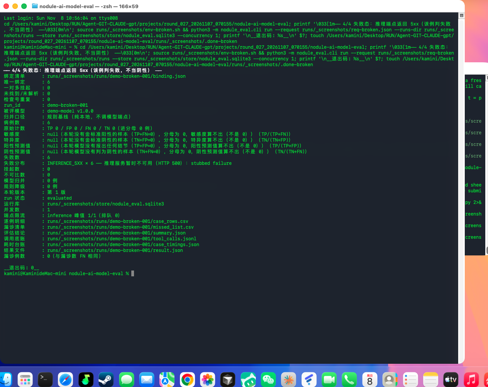
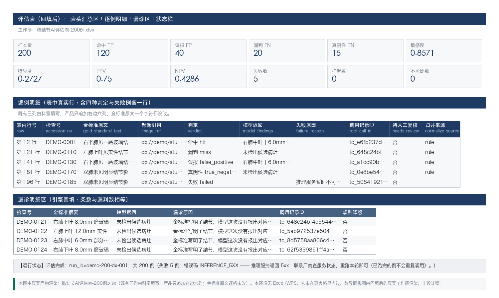
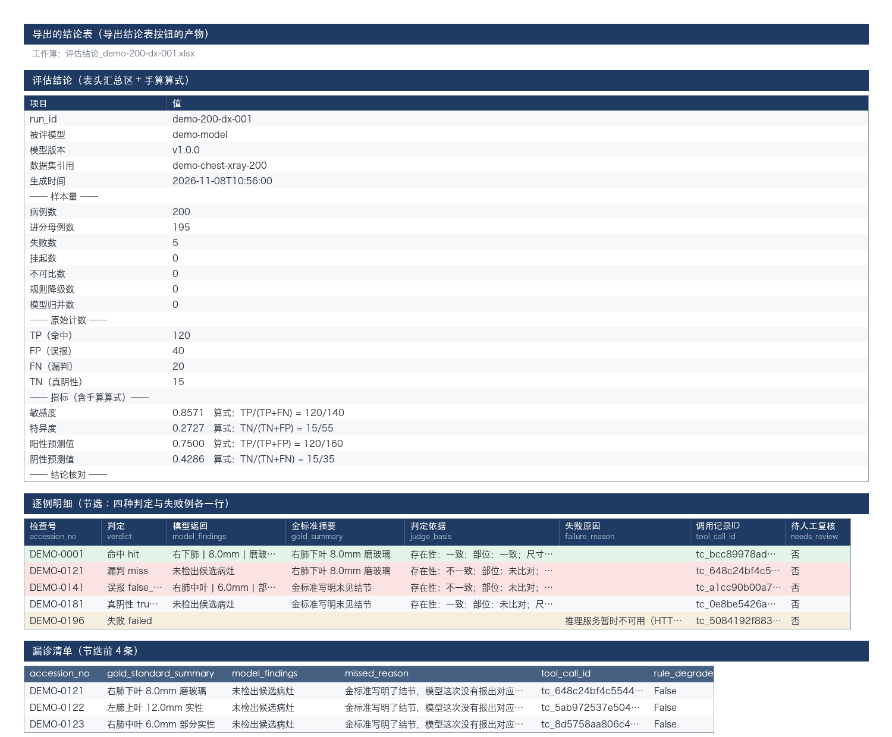
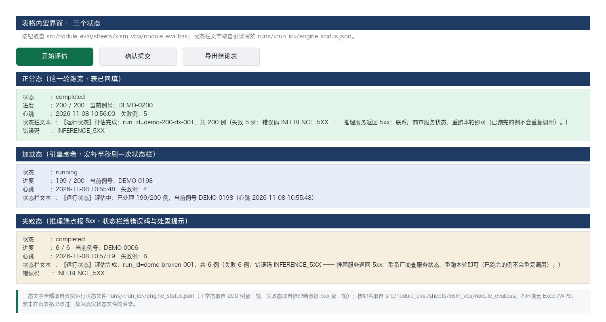

# Pulmonary Nodule AI Model Evaluation System

> The radiology department hands over a 200-case chest X-ray nodule evaluation sheet. The IT department clicks "Start Evaluation" once in the sheet, and the local engine calls the hospital's pulmonary nodule AI inference service case by case, writing the "hit / miss / false positive / true negative / failed" verdicts plus sensitivity and specificity back into **newly added columns of the original sheet**. The same day it delivers an evaluation conclusion with per-case detail and a call ledger; any missed case can be traced back by its "call record ID" to the request and response of that inference call. After manual review and confirmation, the engine idempotently writes the result back to the hospital research platform's evaluation registry.

This system does exactly one thing: **detecting and measuring pulmonary nodules on chest X-ray (DX)**. When procuring a pulmonary nodule AI, upgrading to a new version, or running the annual re-evaluation, it uses the same set of gold-standard cases to measure how many the model missed and how many it over-called. It does not cover CT / MR, other organs, segmentation metrics, or federated evaluation. **The sheet is the interface; the engine is a local command-line process** — the two exchange data through a single JSON contract. There is no web panel and no long-running inbound port.

## Use Cases / Target Roles

| Role | When they use it | What they get |
|------|------------|----------|
| Hospital IT clinical-AI application engineer | Before go-live, running every case once after procuring / upgrading / version-swapping a pulmonary nodule AI | An evaluation sheet filled with verdicts, sensitivity and specificity, plus per-case detail and a missed-case list |
| Hospital IT clinical-AI application engineer | When the vendor delivers a new model version and it needs to be compared against the old one | Two evaluation conclusions over the same case set, with every difference traceable case by case |
| Deputy director of radiology | After the gold-standard column is filled in, wanting to know how accurate the AI really is | Per-case hit / miss / false positive / true negative verdicts; the original model response for any missed case is one click away |
| Deputy director of radiology | Disputing a few verdicts and wanting to see what the AI saw at the time | The "call record ID" of each case, which traces back to that inference call's request and response |
| Research / ethics paperwork | When a paper or ethics filing needs to cite this evaluation | An evaluation conclusion carrying a `run_id`, already written back to the hospital research platform registry |

Frequency: monthly or event-driven, 200–500 cases per run. **Not** for day-to-day real-time diagnosis.

## Key Capabilities

- **One click in the sheet runs the whole batch**: circle the cases → click "Start Evaluation" → the engine calls the in-hospital inference service case by case and writes the verdicts straight back into new sheet columns, leaving every existing cell untouched; the status bar shows "processed N/total · current case number" live, and the sheet never freezes.
- **Five mutually exclusive verdicts, distinguishable at a glance**: every case lands in exactly one of "hit / miss / false positive / true negative / failed"; a failure stays a failure and is never passed off as a negative and folded into sensitivity.
- **Metrics a human can recompute by hand**: the summary area gives the raw counts (TP / FP / FN / TN), sensitivity / specificity / PPV / NPV, the failure count, the degraded count, the held count and the non-comparable count side by side; when a denominator is zero it reports "no sample" instead of 0.
- **A missed case is one click from the original call**: every row carries a "call record ID" that looks up that inference call's request and response, answering "on what basis was this case called a miss".
- **The gold standard is never rewritten, and nothing leaves the hospital without review**: the model only writes to its own normalization columns — not a single character of the gold-standard or existing business columns is touched; conclusions stop at the draft layer by default, and only a human clicking "Confirm and Submit" writes back to the research platform. Resubmitting the same evaluation produces exactly one registry entry on the far side.

## Quick Start

**The sheet comes first**: once the engine and the macros are installed, day-to-day operation happens entirely inside the evaluation sheet —

1. Open the evaluation sheet (`templates/eval_template.xlsx` or the department's own sheet) and fill in the accession numbers and the gold-standard text;
2. Click "Start Evaluation"; the status bar starts running "processed N/total · current case number";
3. Read the header summary area (sample size, TP/FP/FN/TN, four metrics) and the per-case detail area (five verdicts + failure reason + call record ID).

The command line is the **operations and troubleshooting channel only** (batch runs, re-runs, tracing artifacts, exporting conclusion tables). Its prerequisites and common commands are below.

### Requirements

Python **3.11** (the in-hospital delivery baseline; 3.10 also runs, and `doctor` will say so); packages `requests`, `PyYAML`, `openpyxl`, `python-dotenv`; on the sheet side, either Microsoft Excel (with macros) or WPS Spreadsheets (JSA macros); three endpoints reachable inside the hospital: RIS (read), the vendor's pulmonary nodule AI inference service (write), and the hospital research platform (write).

### Install

```bash
python3 -m venv .venv && source .venv/bin/activate   # Windows: .venv\Scripts\activate
pip install -r requirements.txt                       # install dependencies
pip install -e .                                      # install this project (editable, so tests/ runs directly)
```

The macros behind the sheet's three buttons are installed separately — see [`docs/macro_install.md`](docs/macro_install.md): on the Excel side, add the directory holding the evaluation sheet to the trusted locations in the Trust Center; on the WPS side, turn off sandbox protection. Neither macro depends on third-party libraries or ActiveX controls. If the macros cannot be installed, the tool still works — running the CLI directly and using `fill` to write results back is the no-macro fallback.

### Configure

Credentials are **read from environment variables only**; the code sets no silent defaults and never falls back to a local stand-in. Copy `.env.example` to `.env` and fill in the real in-hospital values (the full variable table is under "Key Configuration Items" below; offline installation is covered in [`docs/install.md`](docs/install.md)):

```bash
cp .env.example .env    # edit .env: addresses and tokens for the three endpoints, plus the model gateway address and model name
```

Do not guess when the configuration is incomplete — `doctor` names the exact variable that is missing.

### Build and Verify

```bash
bash scripts/verify.sh                 # one-command end-to-end check: install deps → generate the evaluation sheet → run one fixture evaluation → doctor → assert the artifacts exist
python -m nodule_eval.cli doctor       # self-check: configuration, credentials, model directory, storage writability (zero outbound calls)
python -m pytest tests/ -q             # run the tests
python scripts/build_xlsm.py --out templates/eval_template.xlsx   # generate the blank evaluation sheet template
```

### Main Command Reference

```bash
python -m nodule_eval.cli doctor                                    # self-check right after install (it names whichever variable is missing)
python -m nodule_eval.cli run --cases cases.json --model-id <model> # per-case evaluation (real outbound calls by default, no --fixture)
python -m nodule_eval.cli assemble --cases cases.json                # assemble the hospital's own case set (repeat assembly is skipped)
python -m nodule_eval.cli submit --run-id <run_id>                   # write back to the research platform registry after manual review
python -m nodule_eval.cli inspect --tool-call-id <call-record-id>    # trace back to one inference call's request and response
python -m nodule_eval.cli export --run-id <run_id> --out-dir exports/ # export the conclusion table and missed-case list (no-macro fallback)
python -m nodule_eval.cli fill --sheet eval-sheet.xlsx --run-id <run_id>  # write verdicts back into the sheet (new six columns only)
```

Full parameters, artifact locations and exit codes for each subcommand are in [`docs/cli.md`](docs/cli.md).

## Commands / API / Configuration

### Key Configuration Items

| Item | Default | Description |
|--------|--------|------|
| `RIS_BASE_URL` / `RIS_API_TOKEN` | none (required) | Hospital RIS base address (fetch the study list by accession number) / access token, used as `Authorization: Bearer` |
| `INFERENCE_BASE_URL` / `INFERENCE_API_TOKEN` | none (required) | Vendor pulmonary nodule AI inference service base address / access token |
| `RESEARCH_PLATFORM_BASE_URL` / `RESEARCH_PLATFORM_TOKEN` | none (required) | Hospital research platform base address / access token |
| `OPENAI_BASE_URL` / `OPENAI_API_KEY` / `OPENAI_MODEL` | none (required) | Model gateway address (OpenAI-compatible protocol) / API key / model name used for semantic merging |
| `MODEL_TIMEOUT` / `MODEL_MAX_RETRIES` / `MODEL_TEMPERATURE` | `20` / `2` / `0` | Model call timeout in seconds / retry ceiling / merge temperature (fixed at 0 for reproducibility) |
| `--fixture` / `IMAGING_EVAL_FIXTURE` | off / `0` | **For automated tests only**: routes outbound calls to the local stand-ins under `tests/`; the real path **must** run without it |
| `--store` | `%LOCALAPPDATA%/nodule-ai-model-eval/` | Directory where the SQLite run store is written |
| `--run-id` / `--model-id` | auto-generated / required | Identifier for this evaluation (artifact directory and idempotency key are grouped under it) / identifier of the model under evaluation (maps to `models/<model_id>.yaml`) |
| `--concurrency` / `--endpoint-limits` | `4` / follows concurrency | Concurrency ceiling (overflow queues rather than dropping) / per-endpoint in-flight ceiling (a misspelled endpoint name fails on the spot) |
| `--size-tolerance-mm` / `--resume` | `2.0` / off | Size comparison tolerance (a value exactly at the threshold counts as a hit) / resumable run: completed cases are skipped, with no repeat calls and no duplicate ledger rows |
| `--merge` | `rule` | Merge mode: `rule` = rule baseline (purely local); `model` = semantic merge (calls the in-hospital model service, and **automatically degrades to the rule baseline** when it is unreachable — that case still counts toward the metrics and is listed separately as "rule-degraded") |

### CLI Subcommands / API Endpoints

| Command or path | Purpose | Key parameters |
|------------|------|----------|
| `run` / `assemble` | Evaluate a batch of cases one by one, producing verdicts, metrics, a missed-case list and a call ledger / assemble the hospital's own case set from RIS (idempotent by accession number — a second assembly does not touch RIS at all) | `--cases` `--request` `--model-id` `--resume` `--concurrency` `--merge` / `--accession` `--modality` `--from` `--to` |
| `submit` | Idempotently write back to the research platform's evaluation registry after manual review (no outbound call at all until it is reviewed) | `--run-id` `--review` `--dry-run` `--submitted-by` |
| `inspect` | Trace back to one inference call's request and response by call record ID, and join it back to the per-case conclusion | `--tool-call-id` `--run-id` `--snippet` `--json` |
| `redact-scan` / `replay` | Scan artifacts for identifiable patient detail / replay the write-back receipt (zero outbound calls by default) | `--run-id` `--json` / `--run-id` `--verify` `--json` |
| `doctor` | Check configuration, credentials, model directory, storage and dependencies item by item (zero outbound calls, never opens the stand-in gate) | `--json` `--store` `--models-dir` `--runs-dir` `--verify-dataset` |
| `export` / `fill` | Export the conclusion table and missed-case list / write the verdicts back into the evaluation sheet (new six columns only) | `--run-id` `--out-dir` / `--sheet` `--run-id` |
| `GET {RIS_BASE_URL}/api/v1/imaging-studies` | Outbound **read**: fetch the hospital's chest X-ray study list by accession number (cursor pagination) | `modality=DX` `from` `to` `cursor` |
| `POST {INFERENCE_BASE_URL}/api/v1/detections` | Outbound **write**: call the model under evaluation per case for nodule detection and measurement | `study_uid` `image_ref` `model_id` `model_version` |
| `POST {RESEARCH_PLATFORM_BASE_URL}/api/v1/model-evaluation-runs` | Outbound **write**: register the evaluation conclusion after human confirmation | `Idempotency-Key` header + a body of metrics and per-case detail |
| `POST {OPENAI_BASE_URL}/chat/completions` | Model gateway: merge free-text gold standards into a fixed label set semantically | JSON Schema structured output |

### Errors and Degradation

| Scenario | What it looks like | How it is handled |
|------|------|----------|
| A credential environment variable is missing | `doctor` / `run` fail outright | **The exact variable name is reported**; it never silently falls back to a local stand-in |
| One accession number matches several images / several time points | The case is held | Judged as a one-to-many ambiguity: the first match is never taken automatically, it waits for a human decision, and it stays out of the metrics denominator |
| The inference service returns a different accession number than requested / a response is missing fields | The case is judged failed | It stays out of the metrics denominator and is never counted as a negative; the failure reason names "accession number mismatch" or the missing field — no 0 is filled in and no empty candidate list is passed off as a negative |
| The inference service returns 5xx / 429 | Retried after a backoff | Exponential backoff, at most 3 attempts; if it still fails the case is judged failed and the remaining cases continue |
| The inference service returns 4xx | Not retried | That case ends immediately without consuming the backoff budget; the failure reason carries the status code and the field name |
| The model gateway is unreachable / times out / returns unparseable output | Merge degrades | Falls back to the rule baseline; that case is marked "rule merge" and counted in the degraded count — it still contributes to the metrics, and the summary row states how many cases degraded |
| Writing back to the research platform returns 5xx | Retried with backoff, then still fails | The state **does not advance**; it is not marked as submitted, and the error code and status code are kept for the record |
| The write-back body exceeds the research platform's limit | The submission is blocked and **not one request is sent** | The error states the actual byte count, the limit and roughly how many cases fit per batch — **no per-case detail is truncated**; start another batched submission as instructed |
| The same evaluation is submitted twice | Only one registry entry is created on the far side | Idempotency key `sha256(run_id|model_id|dataset_ref)`; a replay adds nothing |

> **One failure, one message, three surfaces**: the evaluation sheet's `failure_reason` column, the terminal's "failure distribution" output and the `failures` section of `summary.json` all read the **return value of the same function**, so consistency is not maintained by hand; where each error code is raised, whether it is retryable, whether it enters the metrics denominator and which surface shows it to the user are recorded code by code in [`docs/error_matrix.md`](docs/error_matrix.md)
> (generated from the code — `python scripts/gen_error_matrix.py --check` verifies it).

### Integration with Existing Systems

There are exactly **three** outbound calls — no database server, no account system, no exposed inbound interface. Credentials are read from environment variables only and are never hardcoded.

| Counterpart | Direction | Endpoint and fields | Credential source |
|---|---|---|---|
| Hospital RIS | read | `GET {RIS_BASE_URL}/api/v1/imaging-studies?modality=DX&from=&to=` → `{"items":[{"accession_no","study_uid","modality","study_date","report_status","image_ref"}],"next_cursor":...}` | `$RIS_API_TOKEN` |
| Vendor pulmonary nodule AI inference service | write | `POST {INFERENCE_BASE_URL}/api/v1/detections`, body `{study_uid, image_ref, model_id, model_version}` → `{"study_uid","model_id","model_version","candidates":[{"position","size_mm","density","confidence"}]}` | `$INFERENCE_API_TOKEN` |
| Hospital research platform | write | `POST {RESEARCH_PLATFORM_BASE_URL}/api/v1/model-evaluation-runs`, header `Idempotency-Key: sha256(run_id|model_id|dataset_ref)`, body `{run_id, model_id, model_version, dataset_ref, metrics, case_rows, submitted_by, submitted_at}` | `$RESEARCH_PLATFORM_TOKEN` |

Vendors do not agree on field names for "nodule size", "position" and "density" (`size_mm` / `diameter_mm` / `size`); those differences are absorbed by the response-field mapping in `models/<model_id>.yaml`, so no vendor field name appears in the business code; a mapping that is missing a field fails explicitly and names the one that is missing — nothing is guessed and no default is filled in. The local stand-ins (fixture inference service / fixture RIS / fixture research platform) **exist only under `tests/`** and can only be turned on explicitly via `--fixture` or `IMAGING_EVAL_FIXTURE=1`; they are a verification means, **not** the final integration surface.

## Typical Workflows

### Scenario 1: Radiology hands over the sheet, IT clicks "Start Evaluation" once

1. Radiology fills the hospital's chest X-ray cases into the evaluation sheet: one column of accession numbers, one column of gold-standard text (multi-line is fine); leaving the image reference blank is also fine. IT circles this batch of cases in the sheet.
2. Click "Start Evaluation" → the macro writes the request as JSON and wakes the local engine; the engine calls the in-hospital inference service case by case, fills back six new columns, and the header summary area produces the sample size, TP/FP/FN/TN and the four metrics.
3. Radiology and IT review inside the sheet; disputed cases are marked as pending review.

```bash
python -m nodule_eval.cli assemble --cases eval-sheet-cases.json --modality DX   # equivalent path in a no-macro environment
python -m nodule_eval.cli run --cases eval-sheet-cases.json --model-id demo-model
```

### Scenario 2: The vendor swaps versions, both versions run the same case set

1. Copy the previous evaluation sheet and swap the model under evaluation for the `model_id` of the new version.
2. Run again over **the same accession numbers**, producing a second set of new columns and summary metrics.
3. Put the two conclusions side by side: which cases moved from missed to hit, where the false positives cluster, which side the failures landed on.

```bash
python -m nodule_eval.cli run --cases eval-sheet-cases.json --model-id second-model --run-id eval-v2
python -m nodule_eval.cli export --run-id eval-v2 --out-dir exports/v2/
```

### Scenario 3: Tracing a missed case back to the original call to write a procurement note

1. Pick a case from the missed-case list and note its "call record ID".
2. Trace back to that inference call's request and response: which image went in, which accession number, which model version; how many candidates came back and each one's position, size and density.
3. Paste this together with the basis for the verdict into the attachment of the procurement / version-swap note.

```bash
python -m nodule_eval.cli inspect --tool-call-id <call-record-id> --snippet
```

## Output Samples

Artifacts land in `runs/<run_id>/`. The samples below come from a **real run** (a 200-case desensitized chest X-ray evaluation sheet, `demo-200-dx-001`); accession numbers are placeholders throughout. All artifact samples are in [`docs/examples.md`](docs/examples.md).

### Per-case Verdicts (`runs/<run_id>/case_rows.csv`)

```csv
accession_no,verdict,model_findings,failure_reason,tool_call_id,needs_review,normalize_source,row_no
<ACCESSION_NO_A>,hit,右下肺 | 8.0mm | 磨玻璃,,tc_<ID_0001>,False,rule,2
<ACCESSION_NO_C>,miss,未检出候选病灶,,tc_<ID_0003>,False,rule,4
<ACCESSION_NO_D>,failed,,推理服务暂时不可用（HTTP 500）：重试 3 次后仍失败,tc_<ID_0004>,True,rule,5
```

The five mutually exclusive `verdict` values are `hit` / `miss` / `false_positive` / `true_negative` / `failed`; `normalize_source` is the merge mode (`rule` / `model`). **The artifacts never store the raw gold-standard text** — the gold standard lives only in the evaluation sheet, and the per-case artifacts store only a content hash. (`model_findings` and `failure_reason` carry the vendor model's own Chinese text and the engine's Chinese user-facing message templates respectively, so they are reproduced verbatim here; the verdict codes, column names and error codes are English.)

### Summary Conclusion (`runs/<run_id>/summary.json`)

```json
{"counts": {"tp": 120, "fp": 40, "fn": 20, "tn": 15, "counted": 195, "failed": 5},
 "metrics": {"sensitivity": 0.8571, "specificity": 0.2727, "ppv": 0.75, "npv": 0.4286},
 "manual_check": {"formulas": {"sensitivity": "TP/(TP+FN) = 120/140 = 0.8571"}}}
```

The four metrics and the raw counts come from **the same place**, with the by-hand recomputation formula attached; a metric whose denominator is zero outputs `null` with the reason stated, never 0. The verdict rules and metric definitions are in [`docs/metrics.md`](docs/metrics.md).

## Concept / Actual Comparison

### Visual Target

The visual target card is in [`docs/concepts/visual-target.md`](docs/concepts/visual-target.md), describing the three states (initial / first usable moment / mature form) in structured text: the **surface type** is the Microsoft Excel evaluation sheet (not a web panel, not a terminal table); the **visual language** is a dark-blue header with white text, low-saturation fills for the three verdict tiers (hit / miss / failed, printable in black and white for checking), monospaced right-aligned numeric columns, four uniform decimal places for every metric, fixed column widths and a frozen header; the **information hierarchy** runs top summary area → middle per-case detail area → bottom missed-case area and status bar; the **reachability constraint** is that only effects achievable with the public Excel / WPS APIs and openpyxl are shown — no 3D, no animation libraries, no custom controls.

### Measured Evidence

The seven images captured from a real 200-case run (`demo-200-dx-001`: TP 120 / FP 40 / FN 20 / TN 15 into a denominator of 195 cases, with 5 failures); the command and provenance for each are in [`docs/screenshots/README.md`](docs/screenshots/README.md):















> **Honest annotation**: the top is the form described by the visual target card; the bottom is a **real run's artifacts**. The two are not claimed to be identical, and there are four differences:
> **① The interface carrier differs** — the target is an Excel / WPS window, but this round's environment has neither Excel nor WPS, and the macros were never clicked in a real sheet; the three sheet states are rendered from **real artifacts** (the filled-back workbook, the real run state file, the real exported conclusion workbook), while the four terminal images are raw captures of a real Terminal.app window; **② The data is desensitized sample data** (accession numbers are always `DEMO-xxxx`);
> **③ The in-hospital endpoints were not actually connected** — the inference / RIS / research platform calls ran against local protocol stand-ins (real sockets, real HTTP, real Bearer headers: the protocol surface is exercised, but in-hospital credentials were not available this round); **④ The layout deviates** — the column widths and row heights of the real filled-back sheet will not match the target card pixel for pixel. No after-the-fact mock-ups are generated to paper over the gap.

## Architecture and Data Flow

```
┌──────────────────────────────────────────────────────────────────────────────┐
│  Eval sheet xlsm / CSV - accession_no / gold_standard_text / image_ref       │
│  Existing columns are department-owned; the product only appends new columns │
└───────────────────────────────┬──────────────────────────────────────────────┘
                                │ (1) All three entry points share one JSON contract
                                │   (xlsm macro / WPS JSA macro / direct CSV run)
                                ▼
┌──────────────────────────────────────────────────────────────────────────────┐
│  Local engine  python -m nodule_eval.cli run                                 │
│  caseset -> goldstd -> metrics -> writeback (manual gate)                    │
│  RIS assemble  rule baseline/model  5-value verdict  idempotent write-back   │
│  3-key binding  location/density equivalence  4 metrics                      │
│      ^ store (SQLite, dual state machine, resumable) v                       │
│      +---- audit: call ledger / transition trail / redaction scan ----+      │
└───────────────┬──────────────────────────────────────┬───────────────────────┘
                │ (2) Outbound (env-var credentials)   │ (3) Backfill new columns
                ▼                                      ▼
┌──────────────────────────────────┐   ┌───────────────────────────────────┐
│ RIS  GET  imaging-studies        │   │ Six new columns in the sheet:     │
│ Inference  POST  detections      │   │ verdict / model_findings          │
│ Research  POST  evaluation-runs  │   │ failure_reason / tool_call_id     │
└──────────────────────────────────┘   │ needs_review / normalize_source   │
                                       └───────────────────────────────────┘
```

The finer module breakdown, the run/case dual state machines and the three-level audit chain are in [`docs/architecture.md`](docs/architecture.md).

### Key Invariants

- **Idempotency key**: write-back to the research platform carries `Idempotency-Key: sha256(run_id|model_id|dataset_ref)`; resubmitting the same run over the same dataset creates only one registry entry on the far side.
- **A failure never silently changes data, and never enters the denominator**: a failed call / timeout / non-echoed accession number / missing response field is always judged "failed", never counted as a negative in the metrics and never backfilled with a default; the failure count, degraded count, held count and non-comparable count are listed separately in the summary row and never swallow one another.
- **State validation**: the run state machine is `draft → assembled → running → evaluated → reviewed → submitted`, and illegal transitions are rejected; the engine's internal loops **must not** advance `reviewed` / `submitted` on their own.
- **The gold standard is immutable and the artifacts are redacted**: model output writes only the `model_findings` and `normalize_source` columns, with zero cell-by-cell change to the existing columns and `gold_standard_text` (asserted by a before/after comparison); the artifacts contain only `accession_no` and content hashes — no names, ID numbers or admission numbers that could identify a patient.

## Security and Compliance Boundaries

- This system outputs **evaluation statistics and difference hints** only — no diagnostic advice, no treatment advice, no rewriting of reports, no automatic or delegated signing; the gold-standard text column and the model normalization column are physically separate, and model output never overwrites the original text.
- The artifacts never carry identifiable patient detail — only accession numbers and content hashes — and a redaction scanner checks every artifact before delivery.
- The "effective fact" layer is only ever produced after human confirmation; model output always stops at the draft layer.
- The first release is pinned to nodule detection and measurement on chest X-ray: no CT / MR, no other organs, no segmentation metrics, no federated evaluation.

### Data Sources and Licensing

The product runs on real in-hospital data; local self-testing and scale validation use one **public academic dataset**: **JSRT** (the Japanese Society of Radiological Technologists open database — 247 posteroanterior chest X-rays with hand-drawn nodule annotations, 154 cases with nodules and 93 without), licensed under its academic-use terms (the terms differ slightly between mirrors, so **the strictest one is applied**). It is used **only as local validation data**: cached under `data/jsrt/` (not committed), with desensitized samples under `tests/fixtures/jsrt/`. The fetch script `scripts/fetch_jsrt.py` pulls from public mirrors with **per-file SHA256 verification + a count that must be exactly 247**, pinned in `scripts/jsrt_manifest.json`; with no network it exits non-zero rather than silently skipping or leaving half the data while reporting success. **Public data is not the product's integration surface**: hospital data always goes through the RIS read API; the age, sex and diagnostic conclusions in the original JSRT metadata are **not carried into the repository**. The mirror addresses and provenance are in the `source` / `mirror_urls` fields of `scripts/jsrt_manifest.json`; original paper: Shiraishi J, et al. *Am J Roentgenol.* 2000;174(1):71-74.

## Acceptance and Self-Check

| Acceptance item | Command | Expected result |
|--------|------|----------|
| Dependencies install and the import does not error | `pip install -r requirements.txt && python -c "import nodule_eval"` | Installation succeeds, the import raises nothing |
| Missing credentials are named | `python -m nodule_eval.cli doctor` | The missing environment variable names are listed explicitly, the exit code is non-zero, and it does not fall back to a stand-in |
| The template generates with all columns | `python scripts/build_xlsm.py --out templates/eval_template.xlsx` | A workbook with the existing columns plus the six new ones, including the summary area / missed-case area / status bar |
| The public dataset is fetched and verified | `python scripts/fetch_jsrt.py` / `python scripts/fetch_jsrt.py --verify-only` | Per-file SHA256 and the count of 247 both pass; with no network the exit code is non-zero and a degradation hint is given; a re-check without network passes with exit code 0 |
| A per-case evaluation produces complete artifacts | `python -m nodule_eval.cli run --cases cases.json --model-id <model>` | `case_rows.csv`, `tool_calls.jsonl` and `summary.json` exist under `runs/<run_id>/` |
| The missed-case list matches the FN count | `python -m pytest tests/test_report.py -q` | The number of entries in the missed-case list equals the FN count, and the summary recomputes consistently |
| The call ledger can be traced back | `python -m nodule_eval.cli inspect --tool-call-id <ID>` | That call's request and response are returned, joinable back to the per-case conclusion |
| The gold standard is unchanged | `python -m pytest tests/test_fill_backfill.py -q` | The existing columns and the gold-standard column are identical cell by cell before and after fill-back |
| The merge mode is traceable (which prompt version) | `python scripts/verify_prompt_version.py` | The `prompt_sha256` of every ledger row matches the file hash of `prompts/goldstd_merge.v1.md` character for character, and `prompt_version` is `v1` |
| Verdict rules and metric definitions | See [`docs/metrics.md`](docs/metrics.md) | The five mutually exclusive verdicts, the three classes of isolated cases, the four metrics and the by-hand recomputation formula are consistent between definition and implementation |
| One-command repeatable verification | `bash scripts/verify.sh` | Install deps → generate the evaluation sheet → run one fixture verification → doctor → assert the artifacts exist, exit code 0 |
| All tests green | `python -m pytest tests/ -q` | All pass |

## Project Structure

```
nodule-ai-model-eval/
├── README.md / LICENSE / qrcode.jpg ← Chinese product documentation (this file) / MIT license / official-account QR code image
├── requirements.txt             ← runtime and development dependency list
├── pyproject.toml               ← packaging metadata (after pip install -e . you can run python -m nodule_eval.cli directly)
├── .env.example / .gitignore    ← environment variable samples (no real secrets) / excludes credentials, caches, runtime artifacts
├── docs/
│   ├── cli.md / metrics.md / examples.md / architecture.md ← full subcommand reference · verdict rules and metric definitions · all artifact samples · module layering and the dual state machines
│   ├── error_matrix.md / normalizer-comparison.md ← error-code landing matrix (code-generated) · merge comparison experiment conclusions
│   ├── install.md / macro_install.md       ← offline in-hospital installation · Excel macro and WPS JSA installation and trusted-directory setup
│   ├── concepts/                ← visual target card (structured description, no fabricated images)
│   └── screenshots/             ← real run screenshots (terminal / conclusion table / sheet states) plus a per-image provenance list
├── models/, prompts/            ← directory of models under evaluation (endpoint path / version / response field mapping / authorization switch) · semantic merge system prompt (externalized and versionable, hashed into the call metadata)
├── scripts/
│   ├── fetch_jsrt.py / build_xlsm.py         ← public dataset fetch and verification · evaluation sheet template generation
│   ├── compare_normalizers.py / bench_scale.py ← merge comparison experiment · 2000-case concurrency load test
│   ├── capture_screenshots.py / gen_error_matrix.py ← capture real run screenshots · generate the error-code matrix
│   ├── verify_*.py              ← real-run checks for each main path (contract / doctor / macro handoff / fill-back / prompt version / write-back gate …)
│   └── verify.sh                ← one-command repeatable verification script
├── src/nodule_eval/
│   ├── cli.py                   ← run / assemble / submit / inspect / replay / doctor / export / fill
│   ├── config.py / contracts.py / errors.py  ← environment variable configuration surface · contract shared by all three entry points · unified error-code table
│   ├── engine.py / store.py     ← per-case fan-out scheduling and failure isolation · SQLite run store and the dual state machines
│   ├── caseset.py / catalog.py / gateway.py / writeback.py ← case set and three-key binding · model catalog · ModelGateway · human-gated write-back
│   ├── adapters/                ← outbound layer: http / ris / inference / research_platform / vendor_error
│   ├── datasets/                ← public dataset fetch and verification (jsrt: download / unpack / per-file hash / desensitized samples)
│   ├── goldstd/                 ← gold standard merging: labels equivalence table / rules rule baseline / merge semantic merge / prompt prompt versioning
│   ├── metrics/                 ← judge verdicts / attributes three-layer attributes / strict strictest multi-label / compute metrics / report conclusions
│   ├── audit/                   ← toolcall call ledger / modelcall metadata / state_transition transition trail / redact redaction scan
│   └── sheets/                  ← sheet layer: columns column contract / template template / tokens visual tokens / status status / fill fill-back / xlsm_vba / wps_jsa
├── tests/                       ← tests and stand-ins (stand-ins exist only at this layer, and require explicit activation)
│   └── fixtures/                ← case input samples / model catalog samples / public data desensitized samples / edge-case samples
└── data/                        ← runtime cache (gitignored: the JSRT archive and images land here)
```

## License

MIT

---

Full documentation: see README.md (Chinese).

---

## Follow Us

Scan the QR code to follow our official account for updates and community access:

