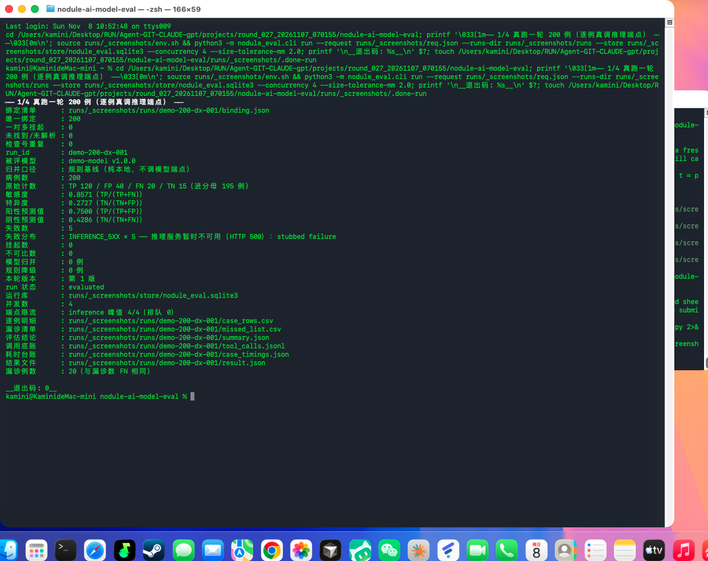
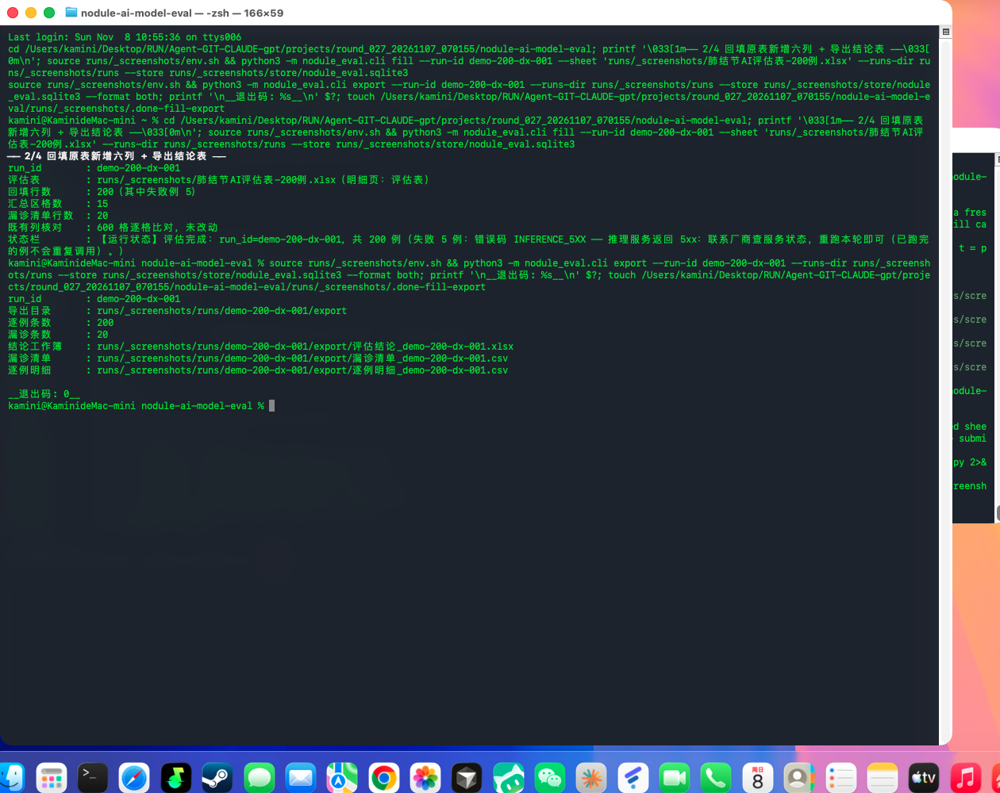
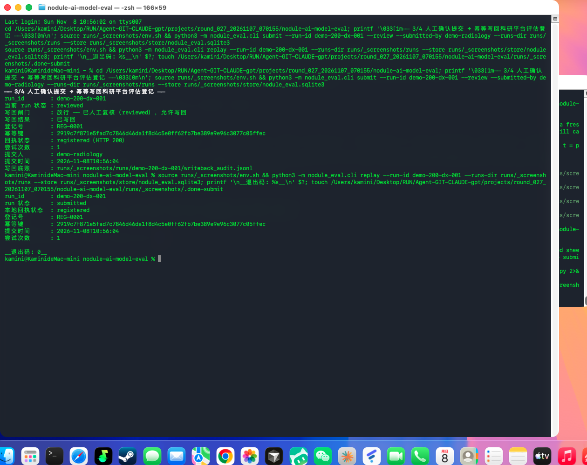
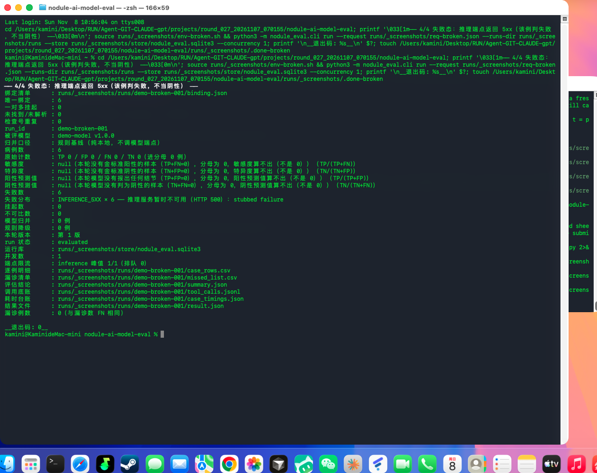
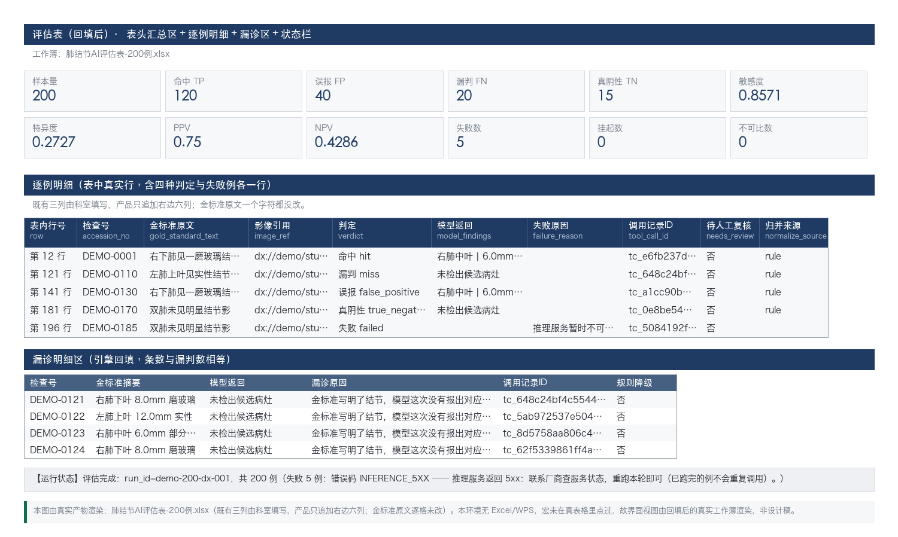
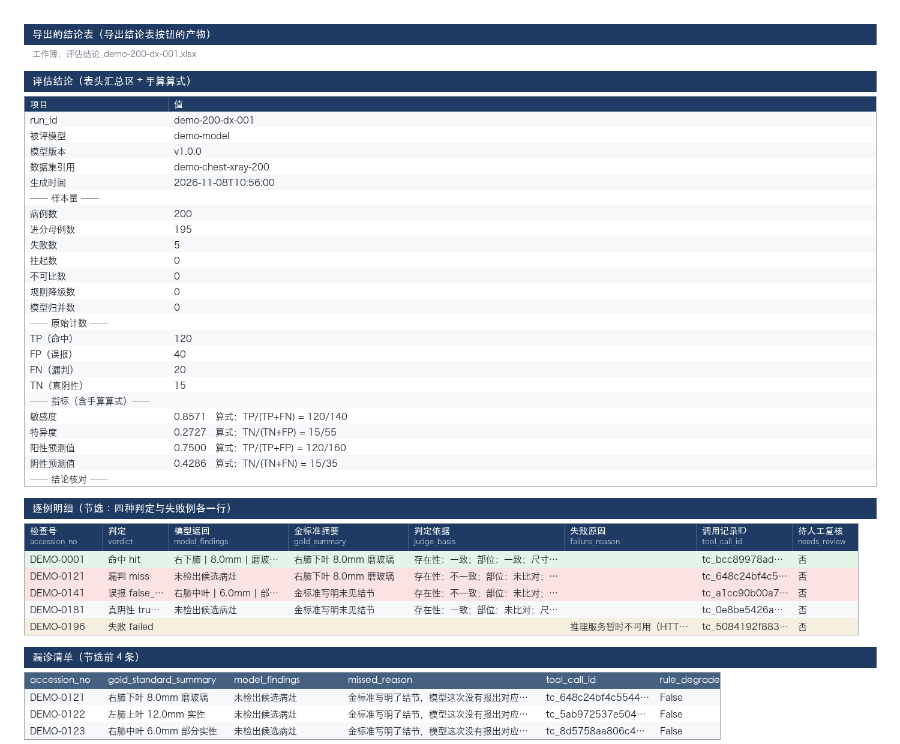
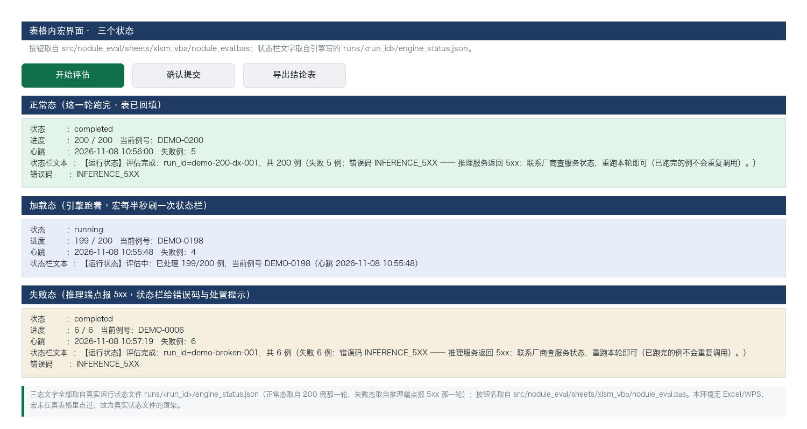

# 实测截图清单（真实运行产物）

> 这个目录里的每张图都来自**一次真实运行**，不是设计稿、不是效果图。
> 本文件逐张写明：**看的什么 · 对应哪条命令 · 产物从哪来 · 有什么做不到**。

---

## 这一轮是怎么跑的

| 项 | 值 |
|----|----|
| run_id | `demo-200-dx-001` |
| 数据集引用 | `demo-chest-xray-200`（200 例胸片肺结节评估表） |
| 被评模型 | `demo-model v1.0.0`（模型目录 `models/demo-model.yaml`） |
| 归并口径 | 规则基线（`--merge rule`，纯本地，不调模型端点） |
| 出站面 | RIS 清单读 / 推理服务写 / 科研平台登记写（+ 模型端点占位） |
| 凭据 | 全部从**环境变量**读（`runs/_screenshots/env.sh`，演示用占位值） |
| 端点地址 | 出站目标经**替身门**改指本地协议替身（`IMAGING_EVAL_FIXTURE=1`） |
| 判定分布 | TP 120 / FP 40 / FN 20 / TN 15（进分母 195 例）+ 失败 5（`INFERENCE_5XX`） |
| 采集脚本 | `python scripts/capture_screenshots.py` |

**替身是真 HTTP**：替身只起在 `tests/` 层（`tests/stub_demo_endpoints.py`），
真监听 socket、真收请求体、真按 `spec.md` 的字段规范回响应；产品的出站代码
（`requests.Session`、URL 拼接、`Authorization: Bearer` 头、请求体字段、响应解析）
**一行都没改**就走完一遍。

**本轮环境没有院内凭证**（也没有 Excel / WPS），所以：

- 推理 / RIS / 科研平台三个端点指向本地协议替身 —— **协议面跑通了，院内端点未实连**；
- 表格界面三态由**真实产物**渲染（回填后的真实工作簿、真实运行状态文件、
  真实导出的结论工作簿），**宏本身没在真 Excel / WPS 里点过**。

---

## 逐张清单

### 1. `01-terminal-run-200-cases.png` —— 真跑一轮 200 例（终端会话）



| 项 | 内容 |
|----|------|
| 看什么 | 终端会话：命令原文 + 逐例跑完的汇总（绑定清单、原始计数、四项指标、失败分布、产物路径、退出码 0） |
| 对应命令 | `source runs/_screenshots/env.sh && python3 -m nodule_eval.cli run --request runs/_screenshots/req.json --runs-dir runs/_screenshots/runs --store runs/_screenshots/store/nodule_eval.sqlite3 --concurrency 4 --size-tolerance-mm 2.0` |
| 产物 | `runs/_screenshots/runs/demo-200-dx-001/`（`case_rows.csv` / `summary.json` / `tool_calls.jsonl` / `missed_list.csv` / `binding.json` / `case_timings.json` / `result.json`） |
| 怎么截的 | macOS Terminal.app **真窗口**跑完命令后 `screencapture -R` 原样截屏 —— 窗口标题、回显的命令、每一行输出都是真的 |

### 2. `02-terminal-fill-and-export.png` —— 回填原表 + 导出结论表



| 项 | 内容 |
|----|------|
| 看什么 | `fill` 的回填台账（回填行数 200、汇总区格数 15、漏诊清单行数 20、**既有列 600 格逐格比对未改动**、状态栏原文）与 `export` 的产物路径 |
| 对应命令 | `python3 -m nodule_eval.cli fill --run-id demo-200-dx-001 --sheet runs/_screenshots/肺结节AI评估表-200例.xlsx --runs-dir runs/_screenshots/runs --store runs/_screenshots/store/nodule_eval.sqlite3` <br> `python3 -m nodule_eval.cli export --run-id demo-200-dx-001 --runs-dir runs/_screenshots/runs --store runs/_screenshots/store/nodule_eval.sqlite3 --format both` |
| 产物 | 回填后的 `肺结节AI评估表-200例.xlsx`；`runs/_screenshots/runs/demo-200-dx-001/export/`（`评估结论_*.xlsx` / `漏诊清单_*.csv` / `逐例明细_*.csv`） |

### 3. `03-terminal-submit-writeback.png` —— 人工确认提交 → 幂等写回科研平台



| 项 | 内容 |
|----|------|
| 看什么 | 写回闸门放行（已人工复核 → 允许写回）、登记号 `REG-0001`、幂等键、回执状态 `registered`（HTTP 200）、提交人与提交时间；随后 `replay` 回放本地回执 |
| 对应命令 | `python3 -m nodule_eval.cli submit --run-id demo-200-dx-001 --review --submitted-by demo-radiology --runs-dir runs/_screenshots/runs --store runs/_screenshots/store/nodule_eval.sqlite3` <br> `python3 -m nodule_eval.cli replay --run-id demo-200-dx-001 --runs-dir runs/_screenshots/runs --store runs/_screenshots/store/nodule_eval.sqlite3` |
| 产物 | `runs/_screenshots/runs/demo-200-dx-001/writeback_audit.jsonl` |
| 意义 | 这是本产品**真正改变业务状态**的那一步 —— 结论进了科研平台评估登记（幂等键 `sha256(run_id\|model_id\|dataset_ref)`，同键重复提交只登记一条） |

### 4. `04-terminal-failed-state.png` —— 失败态：推理端点返回 5xx



| 项 | 内容 |
|----|------|
| 看什么 | 6 例全部失败：`失败数 6`、`失败分布 INFERENCE_5XX × 6`；四项指标显示 `null（本轮没有金标准阳性的样本…）` —— **失败例没被算成阴性**，整批也没被拖垮（run 状态仍是 `evaluated`） |
| 对应命令 | `python3 -m nodule_eval.cli run --request runs/_screenshots/req-broken.json --runs-dir runs/_screenshots/runs --store runs/_screenshots/store/nodule_eval.sqlite3 --concurrency 1` |
| 产物 | `runs/_screenshots/runs/demo-broken-001/`（失败例逐行留底账，可按 `tool_call_id` 反查） |

### 5. `05-sheet-backfill-after-run.png` —— 回填后的评估表



| 项 | 内容 |
|----|------|
| 看什么 | 表头汇总区（样本量 200 / TP 120 / FP 40 / FN 20 / TN 15 / 敏感度 0.8571 / 特异度 0.2727 / PPV 0.75 / NPV 0.4286 / 失败 5）+ 逐例明细（命中 · 漏判 · 误报 · 真阴性 · 失败各一行，底色按判定分档）+ 漏诊明细区（4 条真漏诊）+ 底部状态栏原文 |
| 出处 | **由真实回填后的工作簿渲染**：`runs/_screenshots/肺结节AI评估表-200例.xlsx`（既有三列由科室填写，产品只追加右边六列；金标准原文逐格未改） |
| 限制 | 本环境无 Excel / WPS，**宏未在真表格里点过**；这张图是按真实工作簿的取值与底色渲染的界面视图，不是 Excel 窗口截图 |

### 6. `06-export-conclusion-table.png` —— 导出的结论表



| 项 | 内容 |
|----|------|
| 看什么 | 「导出结论表」按钮的产物三页：评估结论（含**手算复核算式**：敏感度 = TP/(TP+FN) = 120/140）、逐例明细（四种判定 + 失败例各一行）、漏诊清单（3 条真漏诊） |
| 出处 | **由真实导出的工作簿渲染**：`runs/_screenshots/runs/demo-200-dx-001/export/评估结论_demo-200-dx-001.xlsx` |
| 限制 | 同上：由真实产物渲染，非 Excel 窗口截图 |

### 7. `07-macro-ui-three-states.png` —— 表格内宏界面三态



| 项 | 内容 |
|----|------|
| 看什么 | 三个按钮（开始评估 / 确认提交 / 导出结论表）+ 三个状态：正常态（跑完，表已回填）、加载态（**跑的过程中抓到的真实状态文件**：已处理 199/200、当前例号 DEMO-0199、心跳时间）、失败态（错误码 `INFERENCE_5XX` + 处置提示） |
| 出处 | 状态文字全部取自真实运行状态文件 `runs/<run_id>/engine_status.json`；按钮名取自 `src/nodule_eval/sheets/xlsm_vba/nodule_eval.bas` |
| 限制 | 本环境无 Excel / WPS，**宏未在真表格里点过**；这是真实状态文件的渲染，不是 Excel 窗口截图 |

---

## 怎么自己再采一遍

```bash
# macOS：开真终端窗口跑一遍并截图（需本机装了 Excel/WPS 才能看到表格界面）
python3 scripts/capture_screenshots.py

# 只重新渲染表格界面（复用工作目录里已有的运行产物，不重跑）
python3 scripts/capture_screenshots.py --render-only
```

工作目录在 `runs/_screenshots/`（`.gitignore` 已排除，不进仓库）；
产物：评估表、请求 JSON、替身 plan、`env.sh`、运行库与各轮产物。

---

## 与视觉目标的差距（诚实标注）

`docs/concepts/visual-target.md` 描述的是**目标形态**（Excel 窗口里的评估表）；
本目录是**真实运行产物**。差距有四：

1. **界面载体不同**：目标图是 Excel / WPS 窗口；实测图是终端会话 + 按真实产物渲染的界面视图（本环境无 Excel / WPS）。
2. **数据是脱敏样例**：检查号一律 `DEMO-xxxx`、站点地址一律 `*.demo-hospital.internal`，不是真实院内数据。
3. **端点未实连**：推理 / RIS / 科研平台三个端点走的是本地协议替身（真 socket、真 HTTP、真 Bearer 头），院内端点与院内凭证本轮拿不到。
4. **版式有偏差**：真实回填后列宽、行高、底色与目标卡里的设想不会逐像素一致 —— 目标卡是意图，实测图是现状，**不生成事后效果图去抹平差距**。
